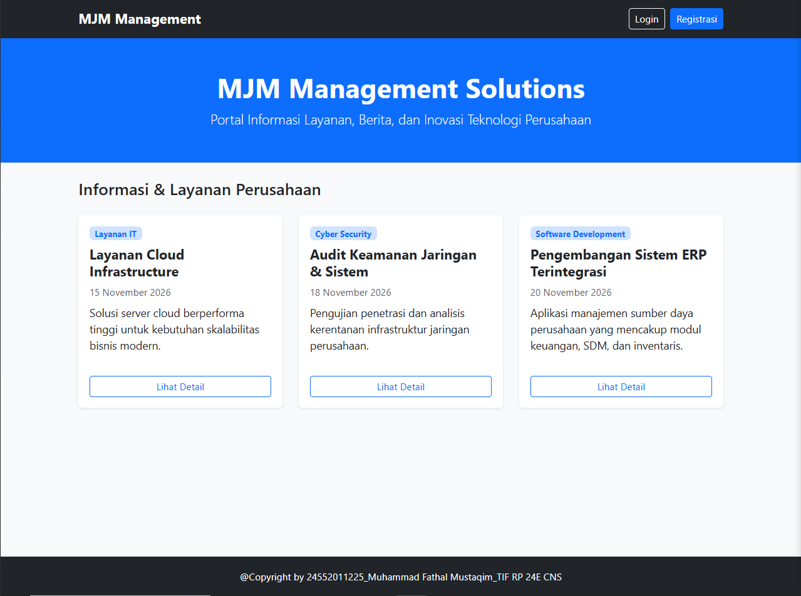
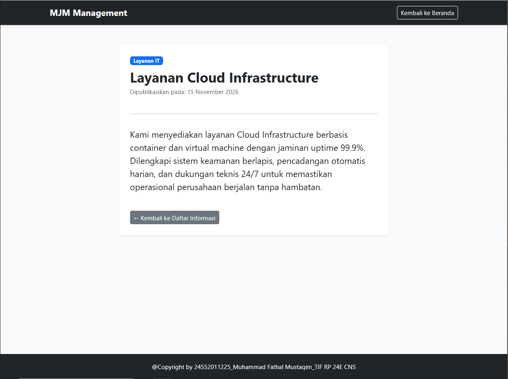
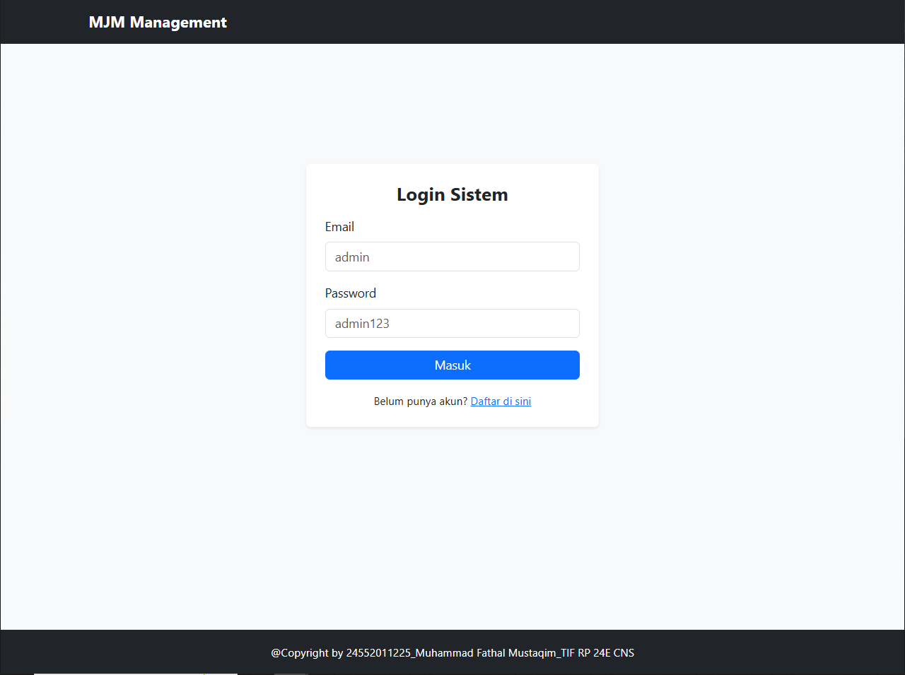
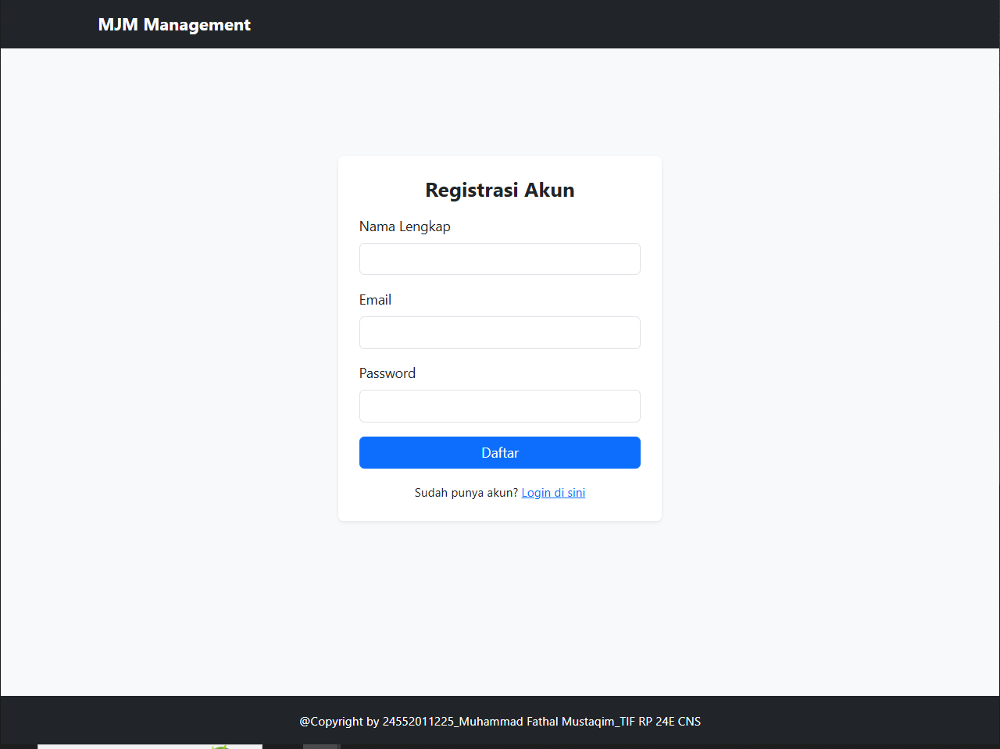
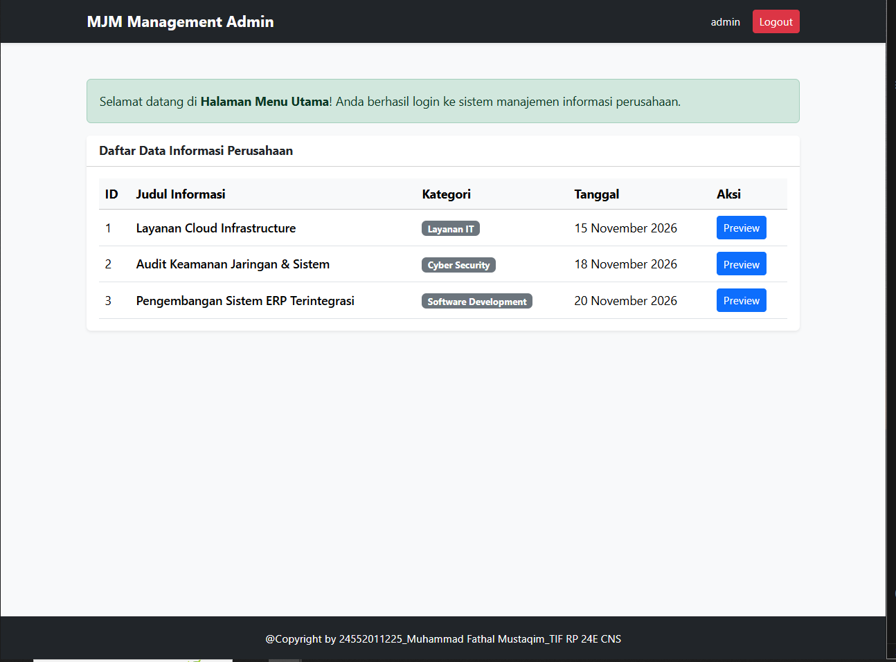
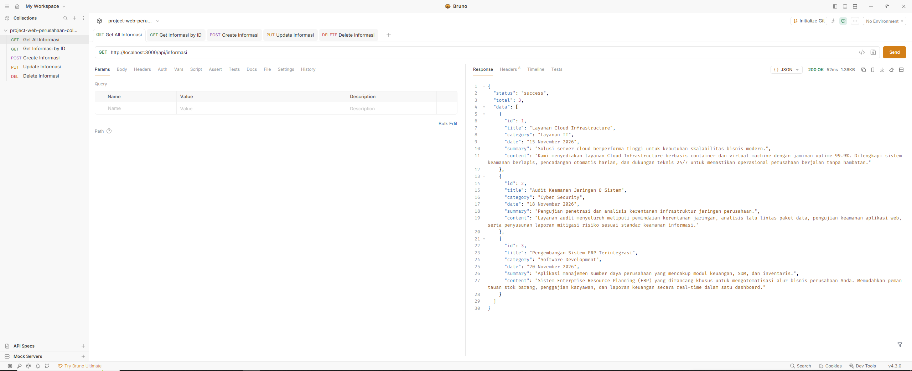
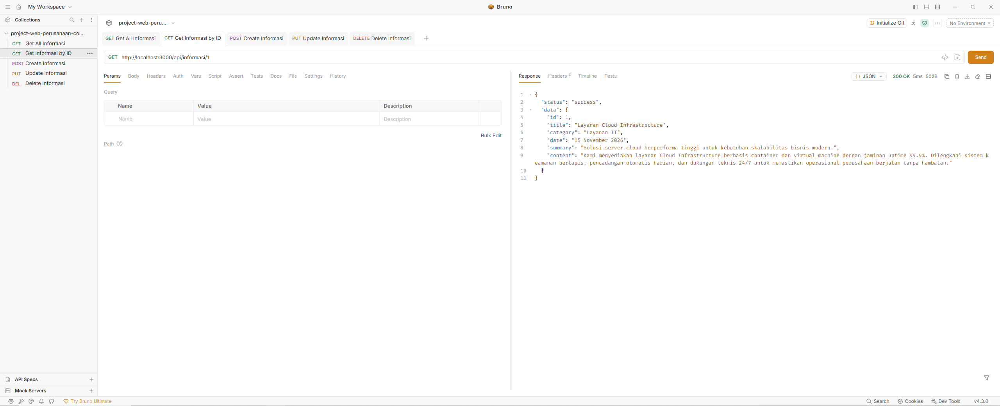
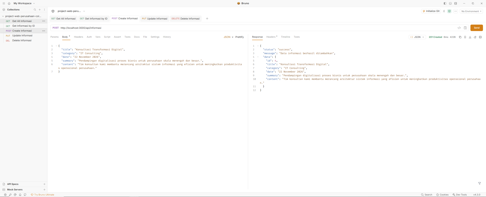
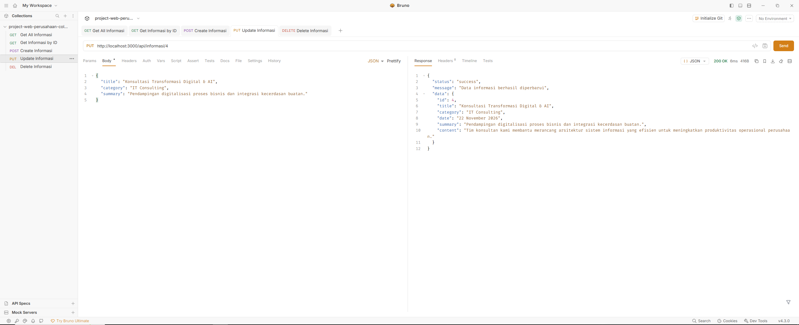
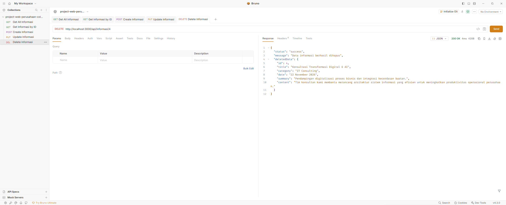

# Project Pemrograman Web - Portal Informasi Perusahaan & CRUD API

**Identitas Mahasiswa:**
- **NPM:** 24552011225
- **Nama:** Muhammad Fathal Mustaqim
- **Kelas:** TIF RP 24E CNS

---

## Project 1: Frontend Web Perusahaan (Bootstrap 5)
Folder: `/frontend`

### Screenshot Tampilan Web
1. **Halaman Utama**
   
2. **Halaman Detail Informasi**
   
3. **Halaman Login**
   
4. **Halaman Registrasi**
   
5. **Halaman Menu Utama (Dashboard)**
   
6. **Halaman Get All Informasi**
   
7. **Halaman Get Informasi By ID**
   
8. **Halaman Post Create Informasi**
   
9. **Halaman Put Update Informasi**
   
10. **Halaman Delete Informasi**
   


---

## Project 2: Backend CRUD API (Node.js & Express)
Folder: `/backend`

### Cara Menjalankan API
```bash
cd backend
npm install
npm start